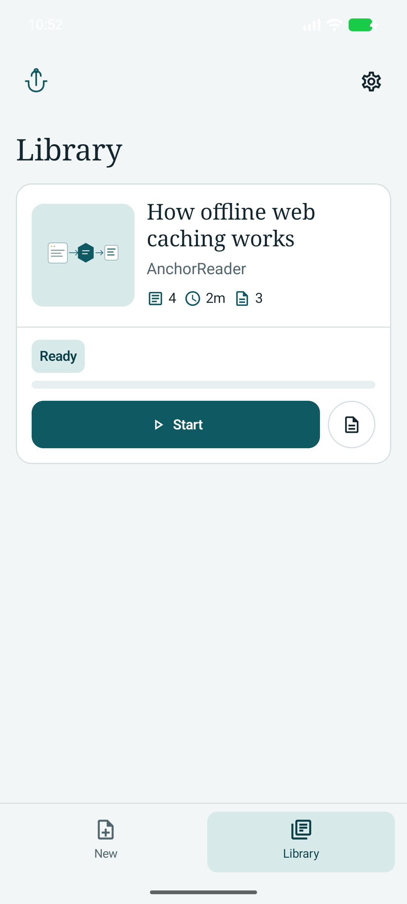
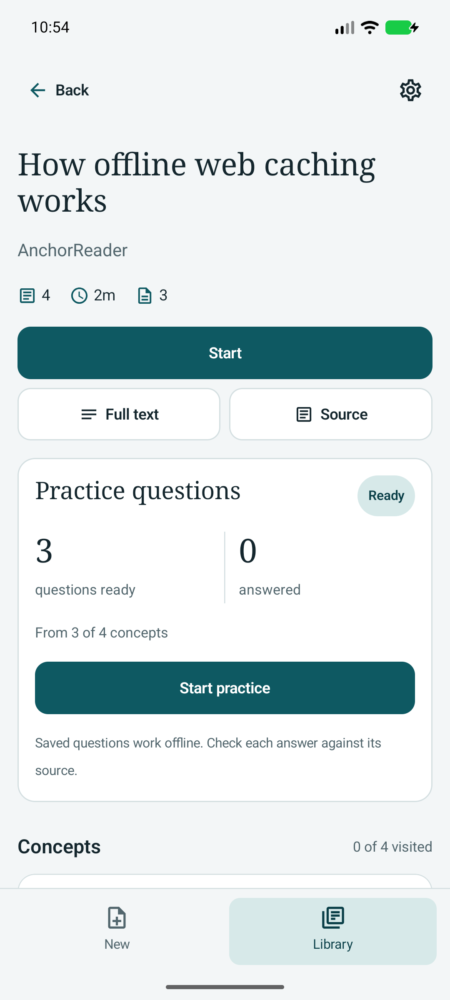
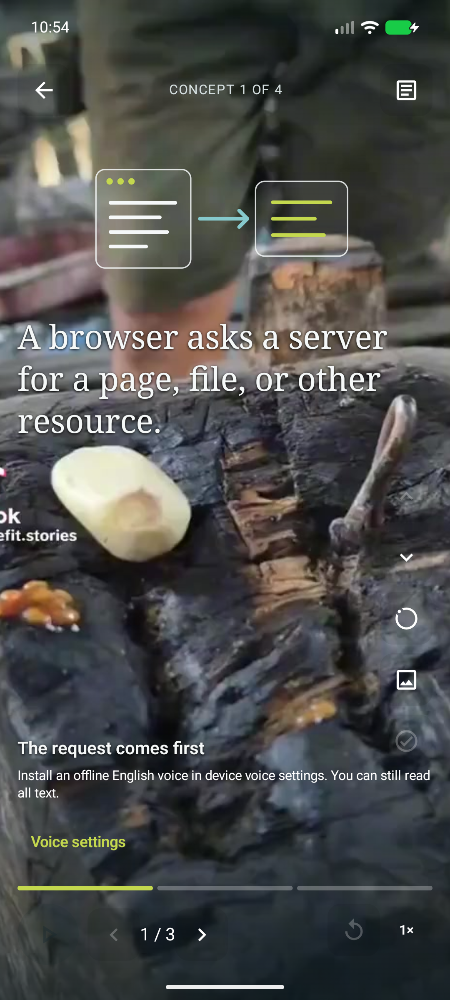
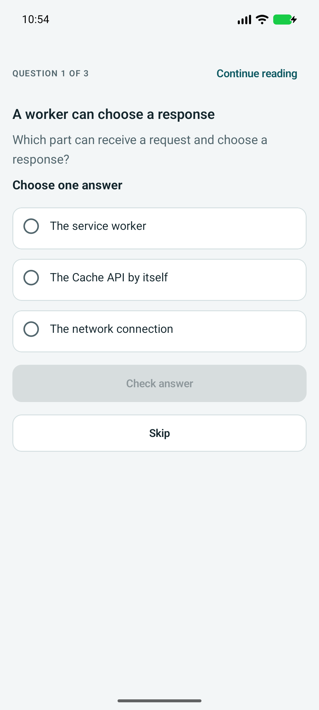
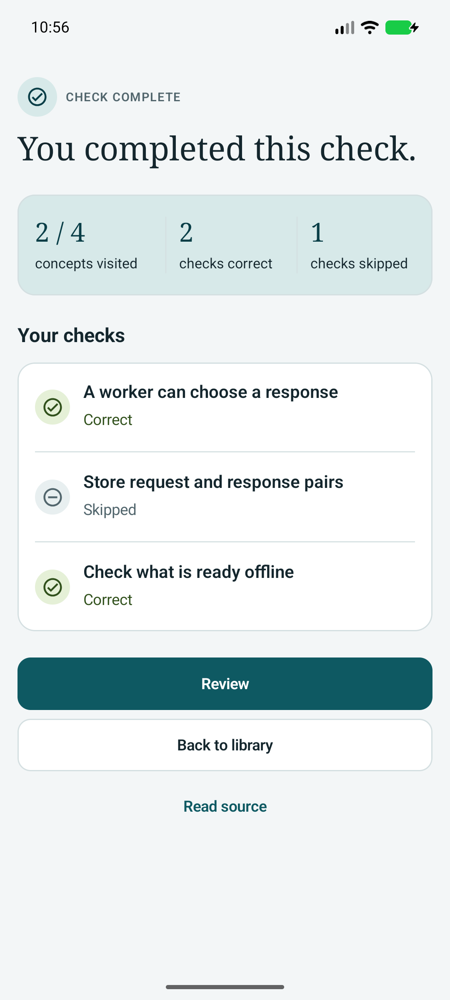
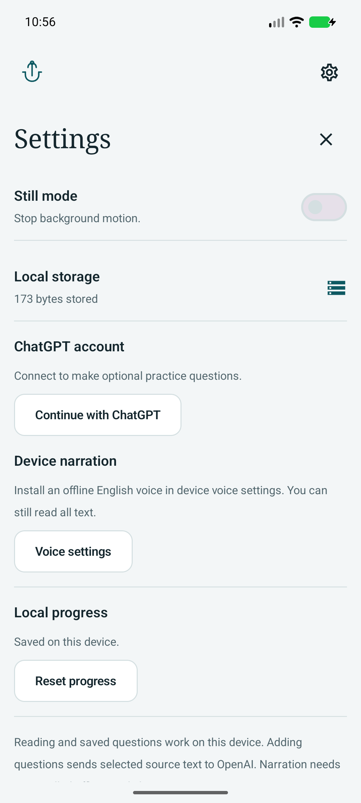

# AnchorReader for Android

Read a book one sentence at a time. Listen with an offline device voice. Check your understanding with saved practice questions.

AnchorReader is a native Android app built with Kotlin and Jetpack Compose. Books, source files, reading positions and practice answers stay on your device. Reading needs no account. You can connect ChatGPT to add optional questions to an imported PDF.

[Download the signed APK](https://github.com/chilliesdev/anchor-reader/releases/latest) · [Release details](docs/RELEASES.md) · [Media and dependency credits](docs/CREDITS.md)

## App screenshots

These are real app screens captured on 14 October 2026. They use the bundled sample lesson on an Android emulator. No account or AI request was used. See [capture details](docs/screenshots/README.md).

<table>
  <tr>
    <td align="center"><br><b>Library</b><br>Open a book or add your own.</td>
    <td align="center"><br><b>Book overview</b><br>Continue reading or choose a concept.</td>
    <td align="center"><br><b>Player</b><br>Read, listen and move between concepts.</td>
  </tr>
  <tr>
    <td align="center"><br><b>Quick check</b><br>Practise the current concept.</td>
    <td align="center"><br><b>Results</b><br>Review correct and skipped answers.</td>
    <td align="center"><br><b>Settings</b><br>Manage narration, connection and progress.</td>
  </tr>
</table>

## What you can do

- Create a book from text or import a digital PDF with the Android file picker.
- Use the Library and book overview to start, continue or review a book. Choose a concept from its outline.
- Read complete sentences. Use sentence controls, or swipe up and down to change concepts. Long sentences use exact display parts when needed.
- Listen with an installed offline English voice. Pause narration, change speed or use a still background. The Player also has a silent workshop video background.
- Open the original PDF, full text or lesson outline. PDF cards use the original first page as their cover.
- Use the bundled lesson, diagram and authored recall checks without a connection.
- Start, resume or repeat saved practice from the book overview. Open Quick check from the Player. Review feedback and grouped results.
- Keep reading positions and answers across app restarts. Inspect storage, clear progress or delete imported books. Clearing progress removes answers but keeps books and saved questions.

## Optional practice questions

For a PDF import, **Add practice questions** is off by default. Save the book first, then connect to ChatGPT if you want questions. You can also add questions later from the book overview.

Generation sends selected section text to OpenAI and needs internet access plus a ChatGPT account with the required plan access. The app uses browser sign-in and Android Keystore to protect saved credentials. No API key or model picker is needed. Settings includes sign-out and Manage usage.

The app saves up to three multiple-choice questions per section. Short sections can have fewer. It checks the response format and quoted source before saving. These checks do not guarantee answer accuracy or teaching quality; check the source. Failed or cancelled generation keeps the saved book readable. Incomplete sections have a retry action. Saved questions and answers work offline.

## Source and offline limits

- Android 8.0/API 26 or later is required.
- PDFs must be no more than 25 MiB, 200 pages and one million text characters. Scanned body pages, encrypted files and damaged files are not supported. An image-only cover can accompany digital body text. There is no OCR.
- Concepts follow source headings, font differences and PDF bookmarks. Without clear section evidence, the book has one `Full document` concept. The app does not create summaries.
- PDF extraction can change reading order. Check the retained original. A missing original PDF cannot be rebuilt from extracted text.
- Reading, retained sources, saved practice and bundled media work offline. Narration needs an installed offline English voice; text stays available if the voice is missing.
- New questions need a connection. Physical-device sign-in, spoken accessibility and acoustic output need separate checks. Emulator screenshots do not verify these.

## Build and run

Install Android Studio, JDK 17 or 21 and Android SDK 35. The first build needs internet access for pinned Gradle dependencies. Open this directory in Android Studio, sync, select `app`, then Run.

Or use the command line:

```sh
./scripts/build.sh :app:assembleDebug
adb install -r app/build/outputs/apk/debug/app-debug.apk
adb shell am start -n com.anchorreader/.MainActivity
```

The build script can use Android Studio's bundled JDK on macOS. Set `JAVA_HOME` and `ANDROID_HOME` for another installation. Keep machine-specific SDK paths in untracked `local.properties`. If more than one device is connected, pass `-s DEVICE_SERIAL` to each `adb` command.

## Validation

```sh
./scripts/build.sh :app:testDebugUnitTest :app:lintDebug
ANDROID_SERIAL=YOUR_TEST_EMULATOR ./scripts/qa.sh device
```

Use a separate test emulator: device tests clear app data. The device command builds and installs the app and instrumentation tests. See the [QA plan](docs/QA_PLAN.md) for test scope. Historical checks are recorded in [QA results](docs/QA_RESULTS.md), [design notes](docs/OPEN_DESIGN.md) and [phone sign-in checks](docs/PHONE_SIGNIN.md); each report has its own revision and limits.

## Releases and signing

Each successful `main` push publishes a signed APK and AAB after that commit's checks pass. [GitHub Releases](https://github.com/chilliesdev/anchor-reader/releases) includes source metadata, checksums and change notes. Install the APK; the AAB is for distribution tools. See [versions, signing setup and safe reruns](docs/RELEASES.md).

```sh
./scripts/build.sh :app:assembleRelease :app:bundleRelease
```

Local release builds are unsigned unless signing is configured. Set `ANCHOR_KEYSTORE`, `ANCHOR_STORE_PASSWORD`, `ANCHOR_KEY_ALIAS` and `ANCHOR_KEY_PASSWORD` for your own release key. Keep keys and passwords outside Git. Older local previews use a different certificate from public releases; preserve needed data before migration. Uninstalling removes local data.

## Project structure

- `app/src/main/java/com/anchorreader/`: app entry point, reading state, narration and source views.
- `data/`: text/PDF extraction, source sections, book storage and practice validation.
- `chatgpt/`: browser sign-in, protected credentials and provider transport.
- `ui/`: Library, book overview, import, practice and Settings screens.
- `scripts/`: build, device QA and GitHub release tools.
- `docs/`: design, QA, release and attribution notes; README screenshots.

This repository contains the native Android app. The bundled lesson explains web caching; it does not make AnchorReader a web app. No measured learning benefit is claimed.
